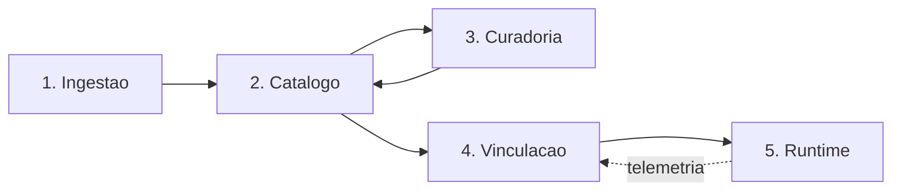

# Arquitetura da Biblioteca de Skills

Documento vivo. Diagrama-fonte: [`ARQUITETURA-BIBLIOTECA-SKILLS.mmd`](./ARQUITETURA-BIBLIOTECA-SKILLS.mmd)

O diagrama completo (com todos os nos e arestas) esta no arquivo `.mmd` acima.

---

## 1. Ingestao

| Caminho               | Codigo                                                                          | Observacoes                                          |
| --------------------- | ------------------------------------------------------------------------------- | ---------------------------------------------------- |
| Harvester GitHub      | `supabase/functions/skill-harvester`, `src/services/skillHarvestService.ts`     | Modo dirigido, paginacao estavel, leitura de licenca |
| Checkpoints           | `skill_harvest_checkpoints`, `src/components/skills/HarvestCheckpointsCard.tsx` | Retomada de sessao, expurgo por `pg_cron`            |
| Composer              | `src/pages/SkillComposerPage.tsx`, `QuickCreateWizard.tsx`                      | Validacao Zod, templates parametrizados              |
| Marketplace/Templates | `openclaw_agent_templates`, `src/services/templateSkillRegistry.ts`             | Instalacao em lote                                   |

Toda entrada converge em UPSERT idempotente sobre `skill_registry`.

## 2. Catalogo

Fonte da verdade: tabela **`skill_registry`** (RLS ativa).

Colunas de governanca relevantes: `department`, `department_confidence`, `department_source` (`lexical` \| `llm` \| `human`), metadados de procedencia e licenca (SPDX normalizado, exibida via `SkillAttributionBadge.tsx`).

## 3. Curadoria

1. **Lexico determinístico** — `src/services/skillDepartmentClassifier.ts`, com margem de seguranca (gap) e blindagem contra ruido.
2. **Fallback LLM em lote** — `src/lib/skills/llmClassificationQueue.ts` → `supabase/functions/skill-classify-llm`, com concorrencia ajustavel, rate limit e sumarizacao de falhas (`queueFailureSummary.ts`).
3. **Enriquecimento de descricao** — `supabase/functions/skill-describe-llm` + `SkillDescriptionEnrichPanel.tsx` (sanitizacao de PII).
4. **Revisao humana auditavel** — `SkillReclassificationReviewPanel.tsx` → RPC `decide_skill_reclassification` grava `department_source='human'` e confianca `1.0`.
5. **Governanca de limiar** — `src/lib/skills/thresholdCalibration.ts` e `classificationEfficacy.ts`: deteccao de instabilidade, override com justificativa obrigatoria (12–280 chars), linha do tempo com filtro "somente sob alerta", export CSV (`calibrationCsv.ts`) e alerta de overrides sem revisao ha 30 dias.

Tudo registrado em `audit_log` via `log_audit_entry()`.

## 4. Vinculacao a agentes

- `src/services/skillDemandService.ts` — demanda real vs. skills orfas, filtros "Sem depto." e "Rever depto.".
- `src/services/skillRecommenderService.ts` — score Jaccard + categoria, sem custo de LLM.
- `src/services/templateSkillLinkService.ts` — instalacao/desinstalacao em lote com restauracao.

## 5. Runtime

`src/services/progressiveSkillLoader.ts` seleciona o subconjunto de skills dentro do orcamento de contexto; `supabase/functions/_shared/skills.ts` compila deterministicamente (sanitizacao anti prompt-injection, deduplicacao, ordenacao alfabetica) antes da injecao no prompt via `llm-gateway`.

A telemetria de uso em runtime realimenta o painel de demanda, fechando o ciclo.
